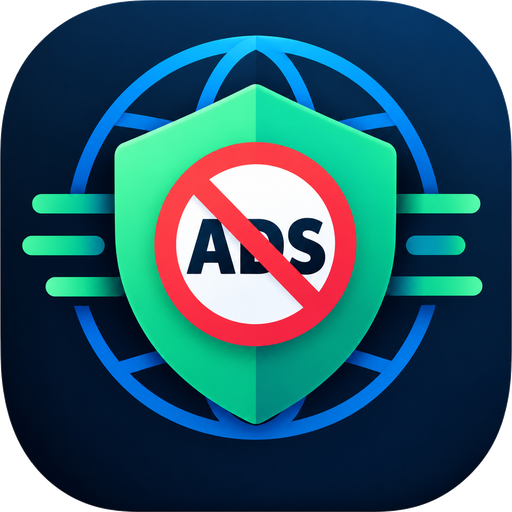
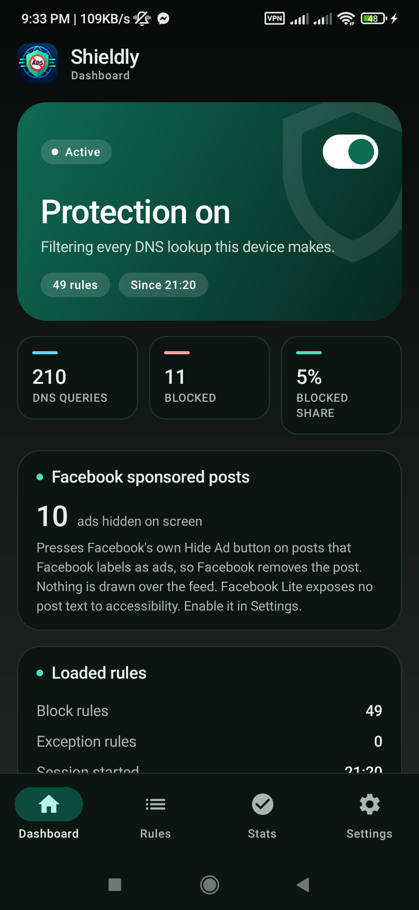
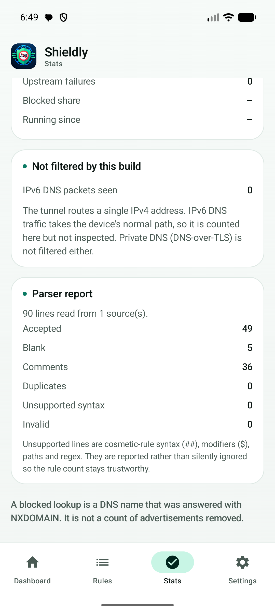
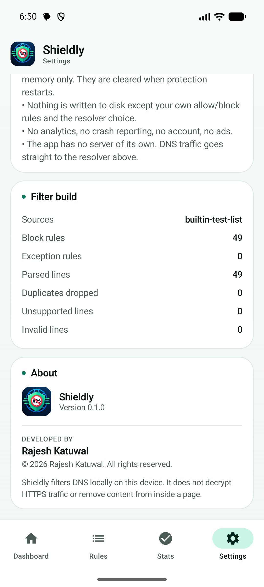
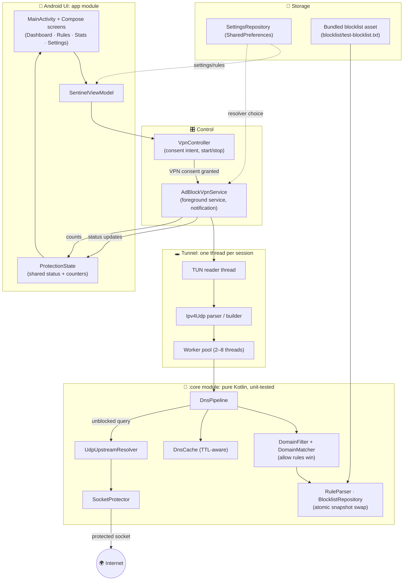
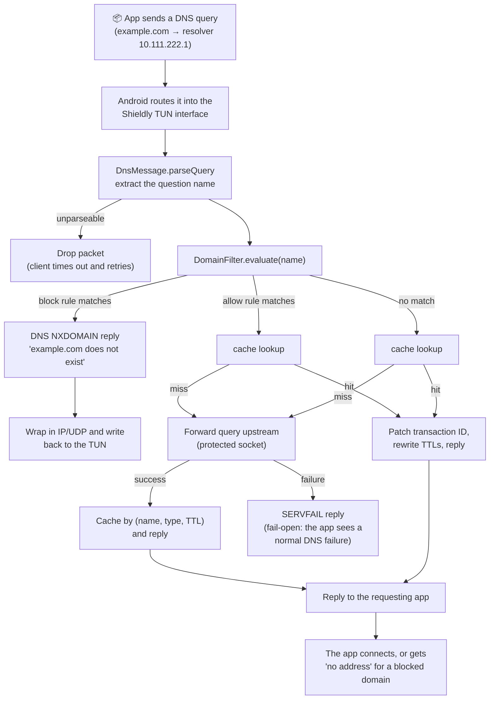
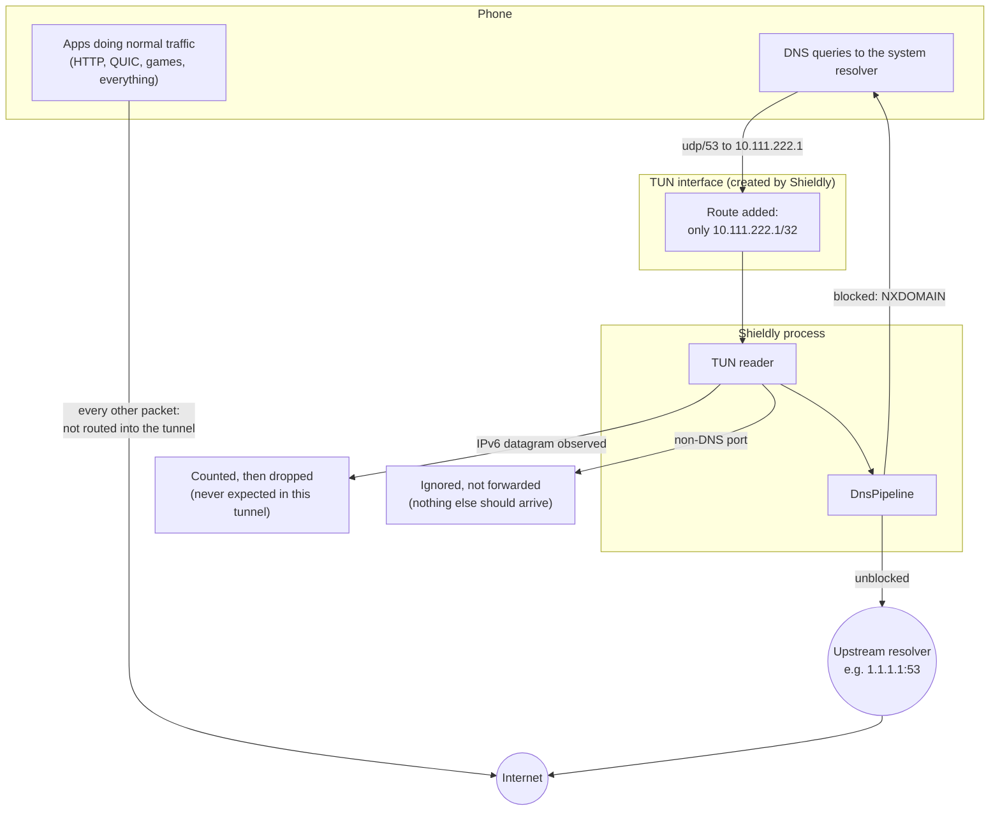

<p align="center">
  
</p>

<h1 align="center">🛡️ Shieldly: a local DNS ad blocker for Android</h1>

<p align="center">
  <a href="https://github.com/RajeshKc777/Sheldly-Ad-Blocker/actions/workflows/android-build.yml">
    
  </a>
  <a href="https://github.com/RajeshKc777/Sheldly-Ad-Blocker/releases/latest">
    
  </a>
  <a href="LICENSE">
    
  </a>
  
  
  
</p>

---

**Shieldly** blocks ad and tracker domains **on your device** by running a tiny local VPN that acts as the device's DNS resolver. Every domain your phone looks up is checked against a blocklist; unwanted ones are answered with "this name does not exist", so apps have nothing to connect to.

> **What this is not:** a magic "remove every ad" button. Shieldly filters at the DNS layer. It cannot see inside HTTPS traffic, it cannot remove an ad served from the same domain as the page you are reading, and it cannot defeat apps that bring their own encrypted DNS. Everything it *can and cannot* do is documented below, with no overclaims.

> **Current status:** working **debug builds**, 118 unit tests, no published release yet, no Play Store build. See [Project status](#-project-status).

---

## 📚 Contents

- [Features](#-features)
- [Project status](#-project-status)
- [Tech stack](#-tech-stack)
- [Screenshots](#-screenshots)
- [Download](#-download-apk)
- [Installation](#-installation)
- [First-time setup](#-first-time-setup)
- [Architecture](#-architecture)
- [DNS filtering pipeline](#-the-dns-filtering-pipeline)
- [DNS filtering explained for beginners](#-dns-filtering-for-beginners)
- [HTTP, HTTPS and TLS explained](#-http-https-and-tls-explained)
- [Blocklist management](#-blocklist-management)
- [Browser-level filtering](#-browser-level-filtering)
- [Privacy and security](#-privacy-and-security)
- [Performance and battery](#-performance-and-battery)
- [Limitations](#-limitations)
- [Troubleshooting](#-troubleshooting)
- [Development](#-development)
- [Contributing](#-contributing)
- [Security policy](#-security-policy)
- [Roadmap](#-roadmap)
- [License](#-license)
- [Developed by](#-developed-by)
- [Acknowledgements](#-acknowledgements)

---

## ✨ Features

| Feature | Status | Notes |
|---|---|---|
| 🧱 **DNS-level domain blocking** | ✅ Implemented | Blocked domain → `NXDOMAIN` reply, so the requesting app cannot connect |
| 🟢 **Allow rules** | ✅ Implemented | A domain you allow wins over every blocklist, including subdomains |
| 🔴 **Custom block rules** | ✅ Implemented | Add domains the bundled list does not cover |
| 🔎 **Rule checker** | ✅ Implemented | Type any domain and see exactly which rule would match it |
| 🌐 **Upstream resolver choice** | ✅ Implemented | Cloudflare, Google, Quad9, AdGuard (plain UDP/53) |
| 📊 **Live counters** | ✅ Implemented | Lookups, blocked, cache hits, IPv6 observations, all in memory |
| 🔀 **Per-app bypass (split tunnelling)** | ✅ Implemented | Apps you exclude (banking, payments, anti-cheat) leave through the real network so they never see a VPN; ads inside them are not filtered |
| 📱 **Facebook sponsored-post hider** | ✅ Experimental | Opt-in AccessibilityService that presses Facebook's own `Hide Ad` button on labelled ad posts, so Facebook removes them, and nothing is drawn over the feed |
| 🔄 **Auto-updating blocklists** | 🟡 Library ready, not wired in | HTTPS fetcher + validator exist and are unit-tested; no UI or schedule yet |
| 🌍 IPv6 DNS filtering | ❌ Not implemented | IPv6 packets are counted, not filtered |
| 🔐 HTTPS inspection | ❌ Not implemented | Deliberately so; see [TLS section](#-http-https-and-tls-explained) |
| 🧭 Browser cosmetic filtering | ❌ Not implemented | No browser is bundled (Phase 8 of the original brief, not started) |

## 📈 Project status

- **Implemented and verified:** local VPN DNS filter, domain matcher with allow-first precedence, TTL-aware cache, upstream forwarding with SERVFAIL fail-open, Compose UI (dashboard / rules / stats / settings), experimental Facebook sponsored-post hider (direct `Hide Ad` press, no overlay), per-app bypass so banking apps keep working behind the filter.

- **Library code, not wired into the app yet:** HTTPS blocklist downloader + validator (`core/…/blocklists/BlocklistUpdater.kt`). The app currently uses only its **bundled starter list (49 rules)**.
- **Not implemented:** IPv6 filtering, DoH/DoT interception, HTTPS content inspection, browser packaging, release signing, Play Store publishing.
- **Verified on hardware:** Xiaomi Redmi Note 8 Pro (Android 11, MIUI). Emulator coverage: API 36.

## 🧱 Tech stack

| Layer | Technology |
|---|---|
| Language | **Kotlin 2.2.21** (two modules: `:app`, `:core`) |
| UI | Jetpack **Compose** (Material 3), single-activity |
| Async | Kotlin coroutines + a small fixed thread pool for the packet loop |
| Networking | Raw `java.net` sockets + `java.nio` UDP; **no third-party network SDKs** |
| Core module | Pure Kotlin JVM module: the filtering and DNS logic is Android-free and unit-tested |
| Build | Gradle 8.14 (wrapper), AGP 8.13.1, JDK 17 |
| Tests | JUnit 4 + kotlinx-coroutines-test: **118 tests, 0 failures** |

## 🖼️ Screenshots

Real screenshots taken from the app running on an API 36 emulator.

| Dashboard | Stats | About |
|---|---|---|
|  |  |  |

## 📥 Download APK

The APK is published automatically by the build workflow.

**➡️ [Download the latest release](https://github.com/RajeshKc777/Sheldly-Ad-Blocker/releases/latest)**

Releases are created when a version tag such as `v1.0.0` is pushed. See
[`docs/RELEASING.md`](docs/RELEASING.md). Until then, every commit's APK is
available as a workflow artifact:
[download from Actions → android-build → Shieldly-debug-apk](https://github.com/RajeshKc777/Sheldly-Ad-Blocker/actions/workflows/android-build.yml).

> The distributed APK is a **debug-signed** build. It installs fine on any device
> but is intended for testing; production signing is documented in
> [`docs/RELEASING.md`](docs/RELEASING.md).

## 📲 Installation

1. Download `Shieldly-<version>-debug.apk` from the [releases page](https://github.com/RajeshKc777/Sheldly-Ad-Blocker/releases/latest).
2. On the phone, allow **Install unknown apps** for the app you will open the APK with (file manager or browser).
3. Tap the APK → **Install**.
   - **Xiaomi/MIUI:** may warn about USB "modified apps"; continue.
4. Open Shieldly → Dashboard → switch **Protection on**.
5. Android shows the **VPN consent dialog** once: *"Shieldly wants to set up a VPN connection"*. Tap **OK**. This is the only gate between the app and your network traffic.

## 🚦 First-time setup

| Step | Where | What happens |
|---|---|---|
| 1 | Dashboard | Toggle **Protection on**. Status becomes *Starting…* then *Protection on* |
| 2 | System dialog | VPN consent (once per install) |
| 3 | Dashboard | Tiles show live counters; "Session started" gets a timestamp |
| 4 | Rules tab | Add your own allow/block rules, or test any domain with the checker |
| 5 | Settings tab | Choose the upstream resolver; enable the experimental Facebook hider if you want it |
| 6 | Any time | Toggle protection off: the tunnel closes and all counters reset |
| 7 | Settings → Facebook sponsored posts | The hider is an accessibility service, not part of the tunnel: it keeps working with Protection **off**. It and the per-app bypass are independent of each other |

Two independent layers, and either can run without the other:

- **Protection (VPN)**: answers DNS for the whole device and refuses ad, tracker and malware domains. Needs the VPN consent and the dashboard switch.
- **Facebook sponsored-post hider**: an accessibility service that presses Facebook's own `Hide Ad` button. Facebook only, and it needs **no VPN**.

Protection cannot hide Facebook sponsored posts by itself: they are served from `facebook.com`, and blocking that host would break the app. That is exactly why the hider exists.

Turning protection off (or uninstalling the app) immediately releases the VPN, so normal DNS resumes. There is nothing to disable in system settings for the DNS layer.

## 🏗️ Architecture

Two Gradle modules:

- **`:app`**: Android layer: Compose UI, `VpnService`, the packet reader/writer, the accessibility service, storage.
- **`:core`**: pure Kotlin (no Android SDK): rule parsing, domain matching, the DNS pipeline, cache, upstream resolver, UDP packet encoding. This is the part covered by unit tests.

### High-level system architecture



### DNS filtering flowchart



### Network traffic flow



The three decisions that define this design:

1. **Only one address is routed into the tunnel** (`10.111.222.1/32`) and that address is set as the device's DNS server. Ordinary traffic never enters the process, so a bug cannot break general internet access.
2. **Shieldly's own traffic is excluded** (`addDisallowedApplication`) so the filter never sees itself.
3. **Fail-open transport, fail-closed claim:** upstream failure → `SERVFAIL` (normal DNS failure); but with zero usable rules the tunnel refuses to start at all, rather than silently filtering nothing.

The full architecture walk-through, including the blocklist update sequence, the protection lifecycle state machine, and the module map, is in **[`docs/ARCHITECTURE.md`](docs/ARCHITECTURE.md)**.

## 🔄 The DNS filtering pipeline

Per query, in order:

1. **Parse**: the raw UDP payload is parsed; unparseable garbage is dropped (the client retries).
2. **Evaluate the question name**: `DomainFilter` checks the domain:
   - **allow rules first** (yours beat everything, including all subdomains),
   - then **deny rules** (yours),
   - then **the bundled blocklist**,
   - otherwise no match.
3. **Blocked** → `NXDOMAIN` reply, built from the query, returned through the TUN. Counted.
4. **Not blocked** → cache lookup keyed by *(name, type, class)*; hits are replied to with their TTLs rewritten for the time already elapsed.
5. **Cache miss** → forwarded over a `protect()`ed UDP socket to your chosen upstream resolver, cached with the minimum answer TTL, and replied.
6. **Upstream failure** → `SERVFAIL` reply so the app gets a clean, normal DNS error instead of a hang.

Every step's counters are shown on the **Stats** tab. A blocked lookup is a DNS name answered with NXDOMAIN, and it is **not** a count of advertisements removed.

## 🌱 DNS filtering for beginners

**What is DNS?** When any app wants to contact `ads.example.com`, Android first asks a DNS server: *"what is the IP address of ads.example.com?"*. That lookup is the internet's phone book.

**What does Shieldly do?** It becomes your phone's phone book. If a number is on your "do not call" list, Shieldly answers *"no such person"* (`NXDOMAIN`). The app that asked gets "address not found" and cannot open a connection. If the domain is fine, Shieldly quietly asks a real DNS server (Cloudflare, Google, Quad9 or AdGuard, your choice) and forwards the answer.

**Why block at DNS level?**

- It works for **every app on the phone**, not just a browser.
- It is cheap: no content is inspected, just one name per lookup.
- It is honest: the app either cannot resolve the name at all, or resolves it normally.

**What it cannot do:** if an app loads its ads from `cdn.somesite.com`, the very same domain as the page content you asked for, and DNS cannot separate "the ad part" from "the article part". DNS only knows names, never URLs, paths, or page content.

## 🔒 HTTP, HTTPS and TLS explained

- **HTTP filtering:** there is none, by design. Shieldly never receives HTTP traffic (only DNS names on UDP/53 enter the tunnel), so it never has to make that decision.
- **HTTPS filtering:** to inspect HTTPS, an app would have to impersonate websites with a custom certificate authority that the phone is forced to trust, and modern apps use **certificate pinning**, which rejects it. Shieldly does **not** install certificates and does **not** decrypt HTTPS. Nothing in this repository can read your TLS traffic.
- **TLS in one sentence:** HTTPS encrypts the *content* of your requests. The *domain name you visited* is still visible to the DNS layer (unless the app uses encrypted DNS), which is exactly the lever Shieldly uses, and why the lever stops at the DNS layer.

| Technique | What it inspects | Shieldly |
|---|---|---|
| Domain filtering (DNS) | The *name* being looked up | ✅ This is the whole product |
| Request filtering (proxy) | URLs inside a decrypted stream | ❌ Not implemented |
| TLS inspection (MITM) | Full HTTPS content via a trusted CA | ❌ Deliberately refused |
| Cosmetic filtering (browser) | Page DOM / UI elements | ❌ Not implemented (the Facebook hider is the closest cousin, scoped to two apps) |

## 📜 Blocklist management

- **Source:** `app/src/main/assets/blocklist/test-blocklist.txt`, a deliberately **small starter list (49 rules)**, not EasyList. It proves the pipeline end-to-end and keeps false positives near zero.
- **Format:** standard hosts/Adblock-domain syntax (`||domain^`, `domain`, `0.0.0.0 domain`), `!` and `#` comments. See [`docs/BLOCKLISTS.md`](docs/BLOCKLISTS.md).
- **Updates:** `core/…/BlocklistUpdater.kt` implements an **HTTPS-only** downloader (redirects are re-checked so a `https→http` downgrade is rejected) with size/line/rule-ratio validation, and unit tests. **The app does not call it yet**: there is no UI, no schedule, no storage for downloaded lists. Until that lands, the list changes only with an app update.
- **Your rules** live in `SharedPreferences` and are applied on every rebuild; a broken edit cannot take down the working list because the snapshot is swapped atomically only after a successful rebuild.

## 🧭 Browser-level filtering

**Not implemented.** There is no bundled browser. The original requirement's Phase 8 ("browser with content filtering") was never started, and nothing in the README pretends otherwise. The experimental **Facebook sponsored-post hider** is the closest implemented feature: an AccessibilityService that hides posts Facebook itself labels as ads by pressing Facebook's own `Hide Ad` button, which makes Facebook remove the post, scoped to `com.facebook.katana` and `com.facebook.lite` only, off by default, and documented with its limits in [`docs/LIMITATIONS.md`](docs/LIMITATIONS.md).

## 🛡️ Privacy and security

- **No backend, no account, no analytics, no crash reporting.** The app talks to exactly one server: the DNS resolver you chose.
- **Counters are memory-only** and reset when protection restarts. Nothing about your browsing is written to disk except your own rules and resolver choice.
- **Permissions:** `INTERNET` (the tunnel forwards DNS), foreground-service declarations, `POST_NOTIFICATIONS` (optional, Android 13+). The Facebook hider additionally needs the accessibility toggle, which only you can grant in system settings.
- **Fail-open transport:** an upstream outage produces a normal DNS failure, never a hang.
- **No certificates are installed. Ever.** Full threat model and reviewer checklist in [`docs/SECURITY.md`](docs/SECURITY.md).

## 🔋 Performance and battery

- The DNS hot path is a single parse + a hash lookup (or a `protect()`ed UDP exchange upstream). It is measured in microseconds of CPU per query.
- The tunnel only receives packets for **one /32 route**; your phone's other traffic does not transit this process at all.
- One low-priority notification while running. No wake-locks, no polling.
- Battery impact is expected to be indistinguishable from idle, but this is **not yet formally measured** across devices (measured only by hand on one device).
- The Facebook hider walks the accessibility tree on feed changes; it debounces and backs off when a scan is slow or battery saver is on. It runs only while Facebook is in the foreground.

## ⚠️ Limitations

The short list; the long list with evidence lives in [`docs/LIMITATIONS.md`](docs/LIMITATIONS.md).

| Limitation | Practical effect |
|---|---|
| Same-domain ads (`cdn.site.com` serves page + ads) | Cannot be separated: DNS knows names, not page parts |
| Apps with hard-coded DNS or **DoH/DoT** (browsers, private DNS in Android settings) | Their lookups bypass the filter entirely |
| IPv6 DNS | Counted, not filtered |
| QUIC / HTTP-3 | Not DNS; never touches the tunnel |
| Ad-URL style blocking (`/ad.png` on a shared CDN) | Not possible without content inspection |
| YouTube, Instagram, Facebook Lite, Reels/video ads | Not removed by DNS; the hider only handles labelled feed posts in the main Facebook app; Facebook Lite exposes no text to accessibility, so nothing can be detected there |
| Banking/sensitive apps | Should work normally (only DNS names are seen), so if one misbehaves, add an allow rule |
| Two VPN apps | Android allows one at a time; enabling another **revokes** Shieldly's tunnel |
| Play Store policy | Accessibility-based UI modification is high-risk; this build is **not** published on Play |
| Sideloading warnings | Android shows "unknown apps" / "restricted settings" prompts; normal for APK installs outside Play |
| Release signing | Not configured in CI yet; the distributed APK is debug-signed |

## 🧯 Troubleshooting

| Symptom | Likely cause | Fix |
|---|---|---|
| "Protection is not running" banner | VPN consent denied or another VPN took over | Toggle protection off and on; accept the dialog |
| Internet stops working | Your chosen upstream is unreachable on your network (e.g. a hotspot blocks UDP/53 to that provider) | Settings → pick a different resolver, then restart protection |
| An app stopped loading content | Over-blocking | Rules tab → add an allow rule for the app's domain, use the checker to find the culprit |
| Counters stay at 0 | The system is using Private DNS (DoT), bypassing the tunnel | Settings → Network → Private DNS → Off, or accept that those lookups are unfiltered |
| Status stuck on *Starting…* | Blocklist rebuild still running (first start) | Wait a few seconds; a cold rebuild is one-time |
| Facebook hider silently stops working | Facebook changed its label/layout | Nothing to fix at runtime; check [Limitations](docs/LIMITATIONS.md) |

**Emergency escape hatch:** turn protection **off** on the Dashboard, or simply uninstall the app: the tunnel disappears immediately with it.

## 🛠️ Development

```bash
git clone https://github.com/RajeshKc777/Sheldly-Ad-Blocker.git
cd Sheldly-Ad-Blocker
./gradlew test assembleDebug        # JDK 17 required
```

- **Requirements:** JDK 17 (Android Studio's JBR works), Android SDK 36.
- **APK output:** `app/build/outputs/apk/debug/app-debug.apk` (~12 MB).
- **Open in Android Studio** for the full IDE experience; `local.properties` with your `sdk.dir` is generated for you (never committed).
- Details: [`docs/BUILDING.md`](docs/BUILDING.md) · tests: [`docs/TESTING.md`](docs/TESTING.md).

## 🤝 Contributing

PRs are welcome. Please read [`docs/CONTRIBUTING.md`](docs/CONTRIBUTING.md) first. The short version: keep the **`:core`** module Android-free and unit-tested, never claim a capability the code does not have, and never add a network dependency for the DNS hot path.

## 🐛 Security policy

Found a vulnerability (e.g. a way to make the filter leak or crash)? Please use [GitHub Security Advisories → "Report a vulnerability"](https://github.com/RajeshKc777/Sheldly-Ad-Blocker/security/advisories/new) rather than a public issue. Do not commit secrets; CI never needs them.

## 🗺️ Roadmap

1. **Wire in the blocklist updater**: UI + schedule + storage for downloaded lists (library already tested).
2. **Release signing in CI** and a signed `v1.0.0` release APK.
3. **IPv6 support** (route `::/128`-style DNS) and DoH upstream option.
4. **Per-app filtering** (route lists).
5. **Battery/latency benchmarks** published in the repo.

## 📄 License

Apache License 2.0: permissive, with an explicit **patent grant** that fits a network-filtering tool, and compatible with the AndroidX/Compose dependencies used here. Full text: [`LICENSE`](LICENSE).

## 👤 Developed by

<p align="center">
  <strong>Rajesh Katuwal</strong><br/>
  <a href="https://github.com/RajeshKc777">https://github.com/RajeshKc777</a><br/>
  <em>© 2026 Rajesh Katuwal. All rights reserved.</em>
</p>

## 🙏 Acknowledgements

- [Android `VpnService`](https://developer.android.com/reference/android/net/VpnService): the platform API the tunnel stands on.
- [Jetpack Compose](https://developer.android.com/jetpack/compose) and [Material 3](https://m3.material.io/): UI toolkit.
- [DNS RFC 1035](https://www.rfc-editor.org/rfc/rfc1035): the wire format `core/dns` implements.
- Public blocklist ecosystem (hosts/Adblock domain syntax): the starter list uses the same syntax so bigger lists can be imported once the updater is wired in.
