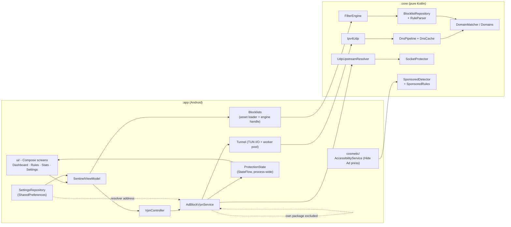
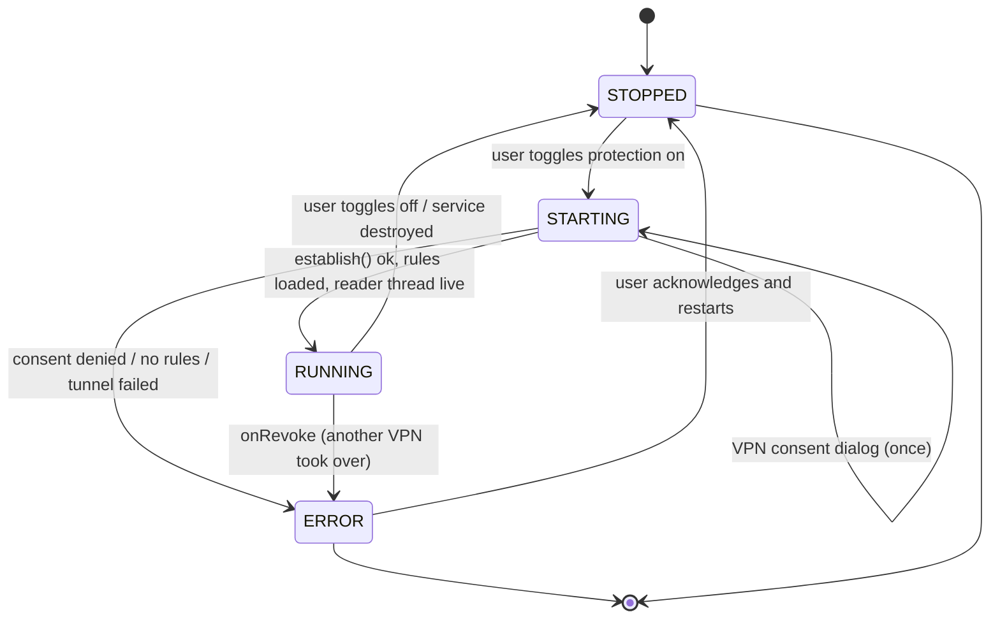

# Architecture

A guided tour of the repository for contributors. Companion to the
[README](../README.md) diagrams; this file adds the code map, the blocklist
update sequence, and the protection lifecycle.

---

## 1. Module layout

```
Sheldly-Ad-Blocker/
├── app/                          # Android application module
│   └── src/main/kotlin/com/sentinel/adblock/
│       ├── MainActivity.kt           # single activity, bottom navigation
│       ├── SentinelApplication.kt    # creates AppContainer
│       ├── data/AppContainer.kt      # manual DI: settings + blocklists
│       ├── monitoring/ProtectionState.kt  # shared status + counters (StateFlow)
│       ├── storage/SettingsRepository.kt  # SharedPreferences (rules, resolver)
│       ├── blocklists/Blocklists.kt  # loads the asset, owns the filter engine
│       ├── vpn/
│       │   ├── VpnController.kt      # consent intent + start/stop intents
│       │   └── AdBlockVpnService.kt  # the tunnel: TUN reader, packet I/O
│       ├── cosmetic/                 # experimental Facebook sponsored-post hider
│       │   ├── FacebookAdHiderService.kt  # AccessibilityService (presses Hide Ad)
│       │   ├── AccessibilityTreeReader.kt # AccessibilityNodeInfo → UiNode + Hide Ad handles
│       │   └── CosmeticStatistics.kt      # session counter
│       └── ui/                       # Compose screens + theme
└── core/                         # pure Kotlin JVM module (no Android SDK)
    └── src/main/kotlin/com/sentinel/core/
        ├── filtering/            # RuleParser, Domains, DomainMatcher, DomainFilter,
        │                         # AllowlistManager, FilterEngine
        ├── blocklists/           # BlocklistRepository, BlocklistUpdater (HTTPS),
        │                         # BlocklistValidator, FilterSnapshot
        ├── dns/                  # DnsMessage, DnsRecordWalker, DnsPipeline,
        │                         # DnsCache, UpstreamResolver
        ├── net/                  # Ipv4Udp (packet encode/parse), SocketProtector
        └── cosmetic/             # SponsoredDetector + SponsoredRules (pure logic)
```

**Design rule:** anything that touches `android.*` lives in `:app`. Everything
that can be expressed in plain Kotlin (parsing, matching, DNS wire format, packet
headers) lives in `:core` and is covered by unit tests. The DNS hot path is
therefore testable on a laptop without an emulator.

## 2. Component relationship



## 3. DNS data path (summary)

The per-query pipeline is: parse → evaluate → (blocked → NXDOMAIN) /
(cache hit → reply) / (forward upstream → cache → reply) /
(upstream failure → SERVFAIL). Full detail: [DNS_FILTERING.md](DNS_FILTERING.md)
and the [README flowchart](../README.md#-dns-filtering-flowchart).

## 4. Blocklist update sequence

The updater exists and is unit-tested in `core`, but the app does **not** call it
yet (no UI, no schedule). The sequence below is what the library does today and
what the future wiring will do around it.

```mermaid
sequenceDiagram
    autonumber
    participant U as UI (future wiring)
    participant UP as BlocklistUpdater
    participant F as HttpsBlocklistFetcher
    participant V as BlocklistValidator
    participant P as RuleParser
    participant R as BlocklistRepository
    participant E as FilterEngine

    U->>UP: fetchAndValidate(id, name, url)
    UP->>F: GET https://… (redirect hops re-checked for https)
    F-->>UP: body (≤8 MiB, timeouts enforced)
    UP->>P: parse(sourceId, body)
    P-->>UP: rules + ParseStats
    UP->>V: validate(body, stats)
    alt validation failed
        V-->>UP: rejected (empty / too large / no usable rules)
        UP-->>U: UpdateResult.Rejected(reason)
        Note over U,R: current list stays active; nothing is installed
    else validation passed
        UP-->>U: UpdateResult.Accepted(RuleSource, ruleCount, warnings)
        U->>E: rebuild(sources)
        E->>R: atomic snapshot swap
        Note over U,E: swap is atomic; a query in flight never sees a half-built set
    end
```

Safety properties that are already true in code:

- **HTTPS-only.** A request to `http://` is rejected outright, and every redirect
  hop is re-checked so a compromised host cannot downgrade the list to plaintext.
- **Resource limits.** 8 MiB / 800k lines / at least one usable rule; oversized
  declared `Content-Length` is rejected before download.
- **No silent install.** The updater only *validates*; installation is a separate
  atomic swap by `FilterEngine`, so "download failed" can never become "lost my
  working blocklist".

## 5. Protection lifecycle



Behaviour details:

| Event | Code path | Result |
|---|---|---|
| Toggle on | `VpnController.prepareIntent` → consent → `startService` | Foreground service starts |
| Consent denied | `MainActivity` result handler | Status → `ERROR` "VPN permission was denied…" |
| No usable rules | `AdBlockVpnService.startProtection` | Refuses to start (**fail-closed claim**) |
| Upstream timeout | `DnsPipeline.handle` | `SERVFAIL` reply (**fail-open transport**) |
| Another VPN enabled | `onRevoke` | Tunnel closed, status → `ERROR` |
| Tunnel torn down | `Tunnel.close` | Descriptor closed, workers stopped, notification removed |

## 6. Threading model

| Thread | Purpose |
|---|---|
| `sentinel-tun` | Reads IP packets from the TUN descriptor; never blocks on DNS |
| `sentinel-dns` (pool, 2–8) | One task per DNS query: pipeline work + upstream socket |
| `Dispatchers.IO` (coroutine) | Start/stop coordination, blocklist rebuild |
| `sentinel-cosmetic` | Accessibility tree walking (Facebook hider) |
| Main thread | UI only; never does file or network I/O |

The reader thread performs no DNS work itself: it parses the packet, hands the
payload to the pool, and continues reading. That is what keeps the tunnel from
falling behind during a burst of lookups.
